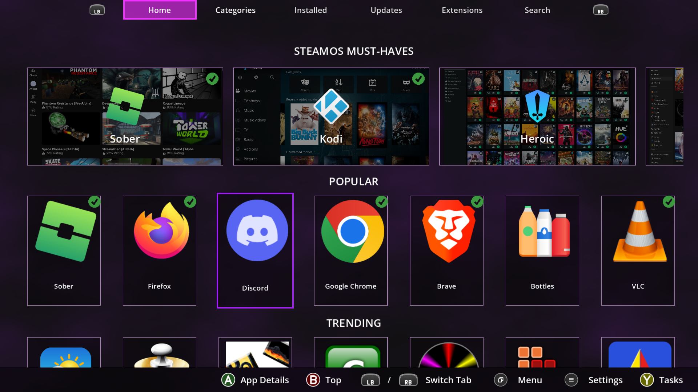

# DeckStore

[](https://www.gnu.org/licenses/gpl-3.0)
[](https://github.com/liberavia/deck-store/actions/workflows/build.yml)
[](https://github.com/liberavia/deck-store/actions/workflows/test.yml)

DeckStore is a modern, open-source App-Store built for SteamOS devices (like the Steam Deck) to browse, install, and update Flatpak applications and community gaming tools directly from **Steam Gaming Mode** with full controller support.



> **A quick note:** I'm developing DeckStore in my spare time as a personal passion project simply because I felt something like this was missing on my own Steam Deck, and I wanted to support the SteamOS ecosystem. It's currently a one-person endeavor, so development happens whenever I have free time. Feel free to use it, test it, and leave feedback, but please be patient with issues!

## Features

- **SteamOS Native Feel:** Built with the Godot Engine for broad hardware support and tailored specifically to a 1280x800 resolution with full gamepad/controller mapping and dynamic controller glyphs (Xbox / Steam Deck / PlayStation / Switch).
- **One-Time Desktop Setup & In-App Self-Updates:** Install once in Desktop Mode—every future DeckStore update can be downloaded and applied directly inside Gaming Mode without ever returning to the desktop.
- **Automatic Steam Library Integration:** Automatically adds installed apps (and DeckStore itself) as "Non-Steam Games" to your Steam library complete with cover, hero, header, and logo artwork.
- **Built-in Extensions System:** One-click installation and updates for essential non-Flathub Steam Deck tools:
  - **Decky Loader** (Official `plugin_loader.service` integration, compatible with existing installations and plugins like Junk-Store)
  - **EmuDeck**
  - **NVIDIA GeForce NOW** (Official native Flatpak repository + automatic controller configuration)
  - **Epic Games Launcher** (Official native Linux AppImage preview)
- **Multilingual Support:** Enjoy DeckStore in multiple languages (English, German, French, Spanish, Italian, Polish, Ukrainian).

## Quick Installation (Steam Deck / Linux)

You only need Desktop Mode **once** to install DeckStore. The installer automatically downloads the latest release to `~/.deck-store/`, registers **DeckStore** in your Steam library, and configures all Steam Grid artworks.

### Option 1: One-Click Desktop Launcher (No Terminal)
1. Switch your Steam Deck to **Desktop Mode**.
2. Download **[`Install-DeckStore.desktop`](https://github.com/liberavia/deck-store/releases/latest/download/Install-DeckStore.desktop)** from the [latest Release](https://github.com/liberavia/deck-store/releases/latest) (or located in [`installer/Install-DeckStore.desktop`](installer/Install-DeckStore.desktop) in this repository).
3. Double-click `Install-DeckStore.desktop` and wait for the progress dialog to complete.
4. Switch back to **Gaming Mode** — **DeckStore** is now ready in your Steam library under *Non-Steam Games*!

### Option 2: Terminal One-Liner
Open *Konsole* in Desktop Mode and run:
```bash
curl -fsSL https://github.com/liberavia/deck-store/releases/latest/download/install.sh | bash
```
*(Or when testing from a local clone of this repository: `./installer/install.sh`)*

## Updating DeckStore

Once installed, you **do not** need to return to Desktop Mode to update DeckStore:
1. Open **DeckStore** in Gaming Mode.
2. Press the **Menu (`≡`)** button on your controller to open **Settings**.
3. Select **Install Update** -> **Restart & Apply**. DeckStore will update itself and restart seamlessly inside Gaming Mode.

## Running from Source (Godot Engine)

If you want to contribute or test DeckStore from the editor:

1. Clone this repository:
   ```bash
   git clone https://github.com/liberavia/deck-store.git
   cd deck-store
   ```
2. Open the project in **Godot 4.7+**.
3. Run the project from the editor or export it using the `Linux` preset (`export_presets.cfg`).

## Feedback & Contributions

Since this is a personal side-project, I'm currently the main developer working on this in my free time. If you run into bugs or have ideas, feel free to open an issue. If you'd like to submit a Pull Request, please take a quick look at the [Contributing Guidelines](CONTRIBUTING.md) to see how the code is structured and tested.

## License

This project is licensed under the [GNU General Public License v3.0 (GPLv3)](LICENSE).
